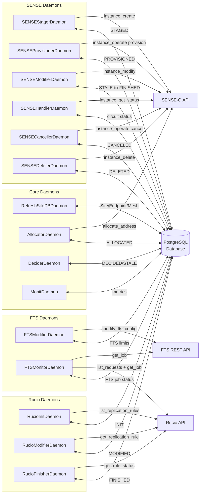
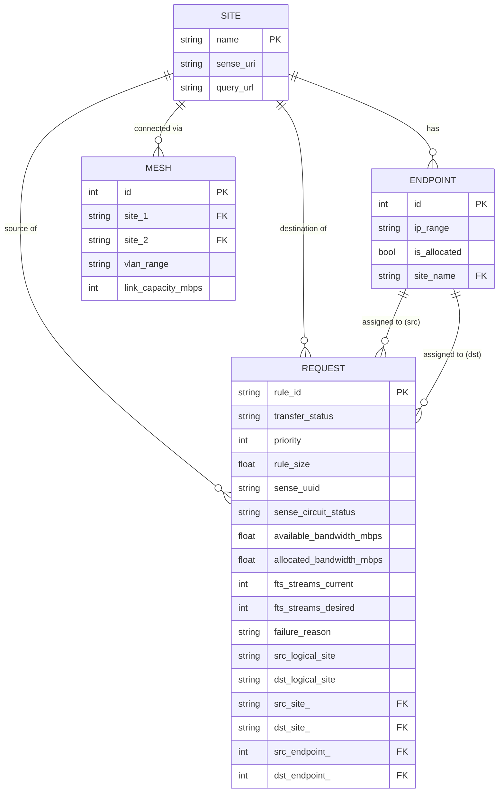
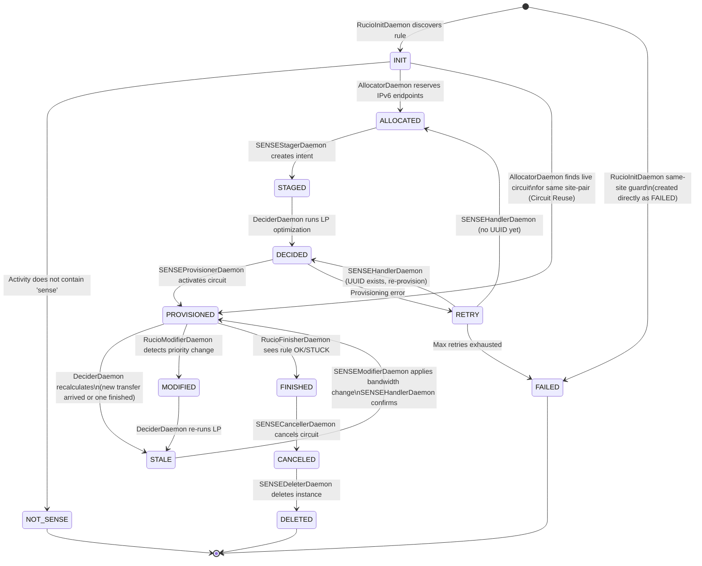
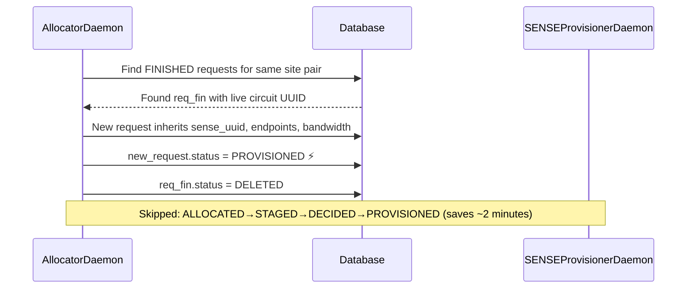
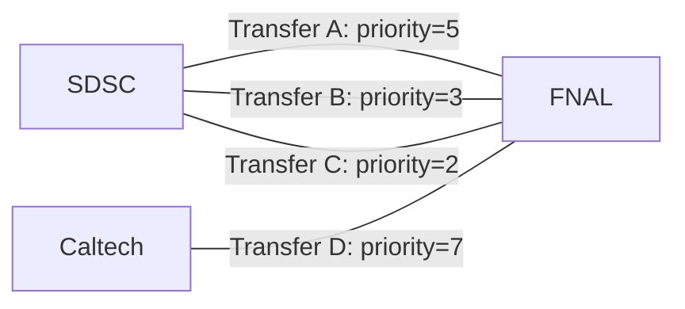
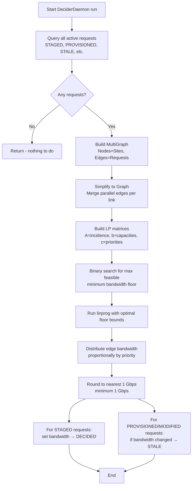
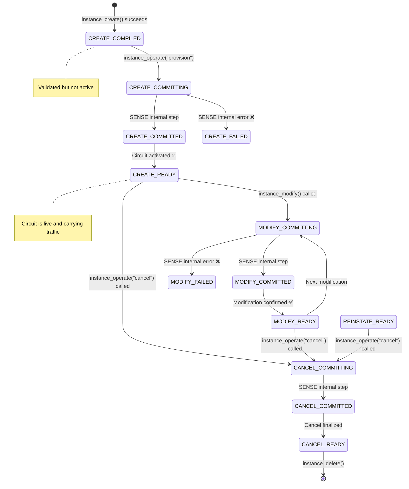
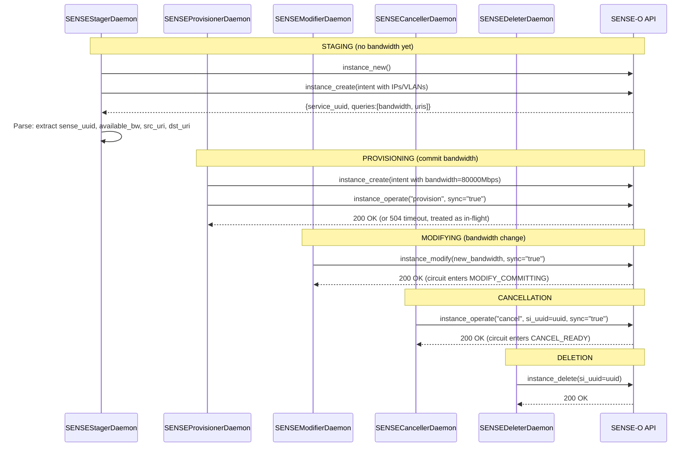

# DMM (Data Movement Manager) — Complete Technical Reference

---

## Table of Contents

1. [Architecture: How DMM is Built](#1-architecture-how-dmm-is-built)
2. [The Data Models](#2-the-data-models)
3. [The Complete Request Lifecycle](#3-the-complete-request-lifecycle)
4. [Daemon Deep Dives](#4-daemon-deep-dives)
5. [The Optimization Engine (DeciderDaemon)](#5-the-optimization-engine-deciderdaemon)
6. [External System Integration](#6-external-system-integration)

---

## 1. Architecture: How DMM is Built
### 1.1 The Architecture Pattern: State-Machine Micro-Daemons
DMM uses a pattern called **State-Machine-based Choreography** (also known as the Kubernetes Controller pattern). Here is the core idea:

> **Every transfer request has a "status" field in the database. Each daemon has a simple job: look for requests in a specific status, do one thing to them, and update their status.**

This is powerful for three reasons:

1. **Reliability (Idempotency)**: If SENSE goes offline for 10 minutes, DMM just keeps retrying. When SENSE comes back, daemons pick up exactly where they left off — because the status is saved in the database, not in memory.
2. **Asynchrony**: Provisioning a SENSE circuit can take 30–120 seconds. One daemon "fires" the request; another daemon "checks" if it's done later. No blocking.
3. **Separation of Concerns**: The engineer writing `RucioInitDaemon` doesn't need to know anything about Linear Programming. They just need to write rules into the database.

### 1.2 Technology Stack
| Layer | Technology | Purpose |
|:---|:---|:---|
| **Language** | Python 3.10+ | All DMM code |
| **Database ORM** | SQLModel + SQLAlchemy | Python ↔ SQL bridge |
| **Database (prod)** | PostgreSQL (psycopg2) | Persistent state storage |
| **Database (dev)** | SQLite | Lightweight local testing |
| **Web Framework** | FastAPI + Uvicorn | The monitoring frontend UI |
| **SENSE Client** | `sense-client` Python library | Talks to SENSE-O REST API |
| **Rucio Client** | `rucio-client` Python library | Talks to Rucio REST API |
| **Math Library** | SciPy + NumPy + NetworkX | LP optimization and graph analysis |

### 1.3 The 15 Daemons at a Glance
DMM runs **15 independent daemon threads** simultaneously. They all share the same PostgreSQL database.

| # | Daemon | Group | Runs Every | Purpose |
|:--|:---|:---|:---|:---|
| 1 | `RefreshSiteDBDaemon` | Core | 2 hours | Bootstraps Site/Endpoint/Mesh tables |
| 2 | `RucioInitDaemon` | Rucio | 10–60s | Discovers new Rucio rules, creates `INIT` requests |
| 3 | `RucioModifierDaemon` | Rucio | 10–60s | Detects Rucio priority changes → `MODIFIED` |
| 4 | `RucioFinisherDaemon` | Rucio | 10–60s | Detects completed rules → `FINISHED` |
| 5 | `AllocatorDaemon` | Core | 10–60s | Reserves IPv6 endpoints via SENSE-O; implements circuit reuse |
| 6 | `DeciderDaemon` | Core | 10–60s | Runs LP optimization → assigns bandwidth |
| 7 | `MonitDaemon` | Core | 60s | Polls Prometheus switch counters for circuit throughput and health |
| 8 | `FTSMonitorDaemon` | FTS | 60s | Polls Rucio + FTS API for per-rule job status and byte counts |
| 9 | `SENSEStagerDaemon` | SENSE | 10–60s | Creates SENSE service intent (no bandwidth yet) |
| 10 | `SENSEProvisionerDaemon` | SENSE | 10–60s | Commits bandwidth and activates SENSE circuit |
| 11 | `SENSEModifierDaemon` | SENSE | 10–60s | Modifies live circuit bandwidth (STALE), throttles finished circuits |
| 12 | `SENSEHandlerDaemon` | SENSE | 10–60s | Polls circuit status, handles retries, affiliates endpoints, rebalances FTS |
| 13 | `SENSECancellerDaemon` | SENSE | 10–60s | Cancels SENSE circuits for finished transfers |
| 14 | `SENSEDeleterDaemon` | SENSE | 10–60s | Deletes SENSE instances, retires records |
| 15 | `FTSModifierDaemon` | FTS | 10–60s | Sets/clears FTS stream limits |

### 1.4 Full Daemon Architecture Diagram


---

## 2. The Data Models
> **What is a Database Model?** A database model is a Python class that defines the structure of a table in the database. DMM uses a library called **SQLModel**, which lets you write Python classes and automatically creates SQL tables from them. Think of a model as the "library card" template — it defines what fields every card must have. An actual row in the table is a filled-out card.

### 2.1 The `Request` Model — The Source of Truth
Every transfer in DMM is represented by one row in the `request` table. This is the most important model.

```python
# src/dmm/models/request.py (annotated)
class Request(ModelBase, table=True):
    rule_id: str              # PRIMARY KEY — the Rucio rule UUID (e.g., "abc123...")
    transfer_status: str      # The current STATE in the state machine (see below)
    priority: int             # Rucio rule priority (higher = more bandwidth)
    rule_size: float          # Total dataset size in bytes
    
    # SENSE circuit information
    sense_uuid: str           # UUID of the SENSE circuit instance
    sense_src_uri: str        # SENSE endpoint URI for the source site
    sense_dst_uri: str        # SENSE endpoint URI for the destination site
    src_vlan: int             # VLAN tag at source (from provision/modify response; used for monitoring)
    dst_vlan: int             # VLAN tag at destination (from provision/modify response)
    sense_circuit_status: str # Real-time status from SENSE-O (e.g., "CREATE - READY")
    sense_affiliated: bool    # Whether endpoints have been affiliated with the circuit
    sense_alloc_rule_id: str  # rule_id of the original allocating request (for circuit reuse)
    sense_provisioned_at: dt  # Timestamp when circuit first became READY
    sense_retries: int        # Number of retry attempts
    sense_status_since: dt    # When sense_circuit_status last changed (for stall detection)
    sense_next_attempt_at: dt # Earliest time to retry a backoff-delayed SENSE call
    sense_escalation: str     # Active escalation label (set when admin intervention needed)
    sense_escalated_at: dt    # When the escalation was raised
    sense_verify_sent_at: dt  # When the last verify request was sent to SENSE-O
    
    # Bandwidth
    available_bandwidth_mbps: float   # What SENSE reported as available (from staging response)
    allocated_bandwidth_mbps: float   # What the LP optimizer decided to give this transfer
    previous_bandwidth_mbps: float    # Previous allocation (before a STALE update)
    
    # FTS stream limits
    fts_streams_current: int  # Current stream limit applied in FTS
    fts_streams_desired: int  # Target stream limit (set by SENSEHandlerDaemon)
    fts_delete_retries: int   # How many times FTSModifierDaemon tried (and failed) to remove the FTS config
    
    # FTS monitoring (JSON columns; populated by FTSMonitorDaemon)
    fts_jobs: dict            # Per-job-id dict of state, file counts, byte counts, timestamps
    fts_summary: dict         # Rolled-up progress across all jobs for this rule
    
    # Monitoring (circuit counters; populated by MonitDaemon)
    prometheus_throughput: float  # Last measured throughput in Mbps (from switch counters)
    prometheus_bytes: float       # Cumulative bytes seen on switch counters since circuit came up
    health: str                   # Health verdict: "1" (healthy), "0" (unhealthy), or None (unknown)
    health_source: str            # Which signal produced the verdict: "circuit" or "fts"
    
    # Priority tracking
    modified_priority: int    # Priority value after a RucioModifierDaemon update (used by DeciderDaemon)

    # Error tracking
    failure_reason: str       # Why the request failed (truncated to 2000 chars)
    failed_at: datetime       # When it failed
    rucio_finished_at: datetime # When the Rucio rule completed
    
    # Logical site names (FEATURE-001: multi-logical-site support)
    src_logical_site: Optional[str]  # Rucio RSE name submitted — always populated by RucioInitDaemon.
    dst_logical_site: Optional[str]  # Rucio RSE name submitted — always populated by RucioInitDaemon.
    # Optional[str] with default=None only to accommodate legacy records created before
    # this feature was added, not because the field is ever conditionally omitted.
    # src_pool_site / dst_pool_site are computed @properties (not stored columns):
    #   return src_logical_site or src_site.name (logical name always wins if present)
    # They select the SENSE-O pool: RUCIO_Site_BGP_Subnet_Pool-<pool_site>

    # Foreign keys (relationships to other tables)
    src_site: Site            # Source storage site (physical SENSE site)
    dst_site: Site            # Destination storage site (physical SENSE site)
    src_endpoint: Endpoint    # Source IPv6 endpoint range
    dst_endpoint: Endpoint    # Destination IPv6 endpoint range
```

### 2.1.1 Request Status & Failure Helper Methods

Instead of setting fields directly, daemons always call these methods on a `Request` object. Each one writes to the database atomically, keeping the record consistent.

| Method | What it does |
|:---|:---|
| `set_status(status)` | Changes `transfer_status` and saves. Used for routine forward progress (e.g., `STAGED → DECIDED`). |
| `mark_failed(reason)` | Sets `transfer_status = FAILED`, records `failure_reason` (trimmed to 2 000 chars), and stamps `failed_at`. Use for **permanent** failures — the request will not be retried. |
| `mark_retry(reason)` | Sets `transfer_status = RETRY` and records `failure_reason`. Use for **transient** errors (timeouts, temporary SENSE errors). `SENSEHandlerDaemon` will move the request back to `ALLOCATED` on the next cycle to try again. |
| `set_failure_reason(reason)` | Records `failure_reason` without changing `transfer_status`. Useful for annotating an in-progress request with why a sub-step failed, while keeping it eligible to continue. |
| `clear_failure_reason()` | Erases `failure_reason` and `failed_at`. Called when a request successfully recovers, so stale error messages don't show in the UI. |

> **Why a 2 000 character cap?** SENSE error blobs and Python tracebacks can be very long. The cap (`FAILURE_REASON_MAX_LEN = 2000`) prevents runaway database row sizes while still keeping enough detail to diagnose most problems. The tail is replaced with `"..."`.

### 2.2 The `RequestStatus` Enum — All 13 States

This is the **complete list** of all states a request can be in. Understanding these is key to understanding DMM.

| Status | Plain English | Which Daemon sets it |
|:---|:---|:---|
| `INIT` | New Rucio rule detected, processing not yet started | `RucioInitDaemon` |
| `NOT_SENSE` | This rule doesn't need a SENSE circuit (activity doesn't contain "sense") | `RucioInitDaemon` |
| `ALLOCATED` | IPv6 subnet addresses reserved; ready for SENSE circuit creation | `AllocatorDaemon` |
| `RETRY` | A transient error occurred (SENSE timeout, etc.); will try again | `SENSEHandlerDaemon` |
| `FAILED` | Permanently failed — max retries exhausted, bad configuration, or same-site guard | `RucioInitDaemon` (same-site guard, record created directly as FAILED) or `SENSEHandlerDaemon` (retries exhausted) |
| `STAGED` | SENSE circuit instance created and has a UUID; no bandwidth committed yet | `SENSEStagerDaemon` |
| `DECIDED` | LP optimizer calculated the bandwidth share; ready to provision | `DeciderDaemon` |
| `PROVISIONED` | SENSE circuit is live and carrying traffic at the allocated bandwidth | `SENSEProvisionerDaemon` |
| `STALE` | Bandwidth needs to change (new transfer arrived or one finished — re-optimization result) | `DeciderDaemon` |
| `MODIFIED` | Rucio rule priority changed; triggers a re-optimization run | `RucioModifierDaemon` |
| `FINISHED` | Rucio rule is done (OK/STUCK/deleted); SENSE circuit is being throttled/cancelled | `RucioFinisherDaemon` |
| `CANCELED` | SENSE circuit successfully cancelled; IPv6 endpoints freed | `SENSECancellerDaemon` |
| `DELETED` | SENSE instance deleted; database record is fully retired | `SENSEDeleterDaemon` |

> **Note**: There is no `FINISHED_R` state in the codebase. The `RucioFinisherDaemon` moves requests directly from `PROVISIONED`/`STALE`/`MODIFIED` to `FINISHED`. The `AllocatorDaemon` circuit reuse logic checks for `FINISHED` requests (not a separate `FINISHED_R` state). The single `FINISHED` status covers both the reuse-window and the throttle-then-cancel pipeline.

### 2.3 The `SenseCircuitStatus` Enum — SENSE Circuit States

These are the statuses that SENSE-O reports about a circuit. They are stored in `request.sense_circuit_status`.

| Status | Meaning |
|:---|:---|
| `CREATE - COMPILED` | SENSE validated the intent but hasn't activated it yet |
| `CREATE - READY` | Circuit is **live and carrying traffic** ✅ |
| `CREATE - COMMITTING` | SENSE is in the process of activating the circuit |
| `CREATE - COMMITTED` | Activation committed, waiting for READY confirmation |
| `CREATE - FAILED` | Circuit creation failed ❌ |
| `MODIFY - READY` | A bandwidth modification completed successfully ✅ |
| `MODIFY - COMMITTING` | SENSE is applying a bandwidth change |
| `MODIFY - COMMITTED` | Modification committed, waiting for READY |
| `MODIFY - FAILED` | Modification failed ❌ (circuit will be rebuilt) |
| `REINSTATE - READY` | Circuit reinstated after a temporary failure ✅ |
| `CANCEL - COMPILED` | Cancel was planned but failed during propagate to site RMs ❌ (force-retry; Issue #109 B1) |
| `CANCEL - COMMITTING` | SENSE has accepted the cancel and is processing it internally |
| `CANCEL - COMMITTED` | Cancel committed, waiting for READY confirmation |
| `CANCEL - READY` | Circuit has been cancelled ✅ |
| `CANCEL - FAILED` | Cancel failed after propagate ❌ (force-retry; Issue #109 B2) |

> **Note on `UNKNOWN`**: `UNKNOWN` is **not** a member of the `SenseCircuitStatus` Python enum. It is a raw string sentinel returned by `get_instance_status()` when SENSE-O returns `None` for a UUID it no longer recognizes (zombie circuit). `SENSEModifierDaemon` compares against this string directly (`if status == "UNKNOWN"`) and resets the request to `ALLOCATED` for re-staging.

### 2.4 The `Site` Model
Represents a storage site (RSE — Rucio Storage Element).

```python
class Site(ModelBase, table=True):
    name: str          # e.g., "T2_US_SDSC" — matches Rucio RSE name, PRIMARY KEY
    sense_uri: str     # e.g., "urn:ogf:network:sdsc.edu:2013:..."  — used in SENSE API calls
    query_url: str     # URL for querying site information
```

### 2.5 The `Endpoint` Model
Represents an IPv6 subnet range that can be assigned to a transfer. Each site has multiple endpoints in a pool; the Allocator picks one when a request starts.

```python
class Endpoint(ModelBase, table=True):
    id: int            # Auto-incremented primary key
    ip_range: str      # e.g., "2001:48d0:4001:1::0/64" — the IPv6 subnet (unique)
    hostname: str      # SENSE-provisioned XRootD hostname (e.g., "xrootd-sense.sdsc.edu")
                       # This is what GET /query/{rule_id} returns to Rucio
    protocol: str      # XRootD protocol info from Rucio (scheme, port, prefix)
    is_allocated: bool # True if currently in use by an active request
    site: Site         # Which site this endpoint belongs to
```

### 2.6 The `Mesh` Model
Defines the "road map" — what network links exist between sites, their bandwidth capacity, and which VLAN tags to use.

```python
class Mesh(ModelBase, table=True):
    id: int                  # Auto-incremented primary key
    site_1: str              # e.g., "T2_US_SDSC"
    site_2: str              # e.g., "T1_US_FNAL"
    vlan_range: str          # e.g., "3602-3606" — VLAN tags for this link
    link_capacity_mbps: int  # e.g., 100000 (100 Gbps) — physical link maximum
```

DMM checks this to enforce: *"I can't give this transfer 80 Gbps if the link between SDSC and FNAL only has 100 Gbps and 40 Gbps is already reserved."*

### 2.7 Entity-Relationship Diagram


### 2.8 Complete Request State Machine


---

## 3. The Complete Request Lifecycle
### 3.1 Happy Path: Step-by-Step Narrative
*Imagine: At 10:00 AM, a user submits a Rucio rule to copy a 5 TB dataset from SDSC to FNAL, with `activity="SENSE Test"`. Here's exactly what happens:*

---

**Step 1: Discovery (10:00:15 AM)**

`RucioInitDaemon` is running every 10 seconds. It calls `client.list_replication_rules()` and scans each rule. It sees the new rule. It checks:
- Is this rule already in the DMM database? **No.**
- Is the rule's state OK or STUCK? **No** (it's REPLICATING).
- Does the activity contain "sense"? **Yes** → this is a SENSE rule.

It looks up `T2_US_SDSC` and `T1_US_FNAL` in the `Site` table, creates a `Request` record, and saves it with `transfer_status = INIT`.

---

**Step 2: Endpoint Allocation (10:00:25 AM)**

`AllocatorDaemon` finds the request with status `INIT`. It first checks: *is there a `FINISHED` request for the same site pair?* No — this is a new site pair. So it:
1. Calls SENSE-O's Address API to reserve a unique IPv6 subnet for SDSC and another for FNAL
2. Finds matching `Endpoint` records in the database
3. Marks both endpoints as `is_allocated = True`
4. Updates the request with the endpoints and sets `transfer_status = ALLOCATED`

---

**Step 3: SENSE Staging (10:00:35 AM)**

`SENSEStagerDaemon` finds the request with status `ALLOCATED`. It:
1. Looks up the VLAN range for the SDSC↔FNAL link from the `Mesh` table (e.g., `"3602-3606"`)
2. Sends a JSON "intent" to SENSE-O's `WorkflowCombinedApi`:
   ```json
   {
     "service_profile_uuid": "...",
     "queries": [
       { "ask": "edit",
         "options": [
           {"data.connections[0].terminals[0].uri": "urn:ogf:network:sdsc.edu:..."},
           {"data.connections[0].terminals[0].ipv6_prefix_list": "2001:48d0:4001:1::0/64"},
           {"data.connections[0].terminals[1].uri": "urn:ogf:network:fnal.gov:..."},
           {"data.connections[0].terminals[1].ipv6_prefix_list": "2001:48d0:4002:1::0/64"},
           {"data.connections[0].terminals[0].vlan_tag": "3602-3606"},
           {"data.connections[0].terminals[1].vlan_tag": "3602-3606"}
         ]
       },
       { "ask": "total-block-maximum-bandwidth", ... }
     ],
     "alias": "abc123-rule-id"
   }
   ```
3. SENSE-O responds with a `service_uuid` and the available bandwidth (e.g., 100,000 Mbps)
4. DMM saves the UUID and available bandwidth, sets `transfer_status = STAGED`

---

**Step 4: Bandwidth Decision (10:00:45 AM)**

`DeciderDaemon` finds all requests in states `STAGED`, `PROVISIONED`, `STALE`, etc. It builds a network graph and runs a Linear Programming optimization (see Part 6) to decide how much bandwidth each transfer gets. For our transfer, let's say it gets **80,000 Mbps (80 Gbps)**.

It updates `allocated_bandwidth_mbps = 80000` and sets `transfer_status = DECIDED`.

---

**Step 5: SENSE Provisioning (10:00:55 AM)**

`SENSEProvisionerDaemon` finds the request with status `DECIDED`. It first checks: are there any `STALE` requests? No. It then checks the circuit's status in SENSE-O. If it's `CREATE - COMPILED` (ready to go), it:
1. Sends a second intent to SENSE-O that includes the bandwidth:
   ```json
   {"data.connections[0].bandwidth.capacity": "80000", ...}
   ```
2. Calls `instance_operate("provision", sync="true")` — telling SENSE-O to activate the circuit
3. Sets `transfer_status = PROVISIONED`

---

**Step 6: FTS Throttling (10:01:05 AM)**

`SENSEHandlerDaemon` polls SENSE-O and sees the circuit is now `CREATE - READY` (active). It affiliates the endpoints with the circuit.

Meanwhile, `FTSModifierDaemon` sees the request is `PROVISIONED` with `fts_streams_current (0) ≠ fts_streams_desired (120)`. It calls the FTS REST API to set `max_active = 120` streams for the SDSC→FNAL pair. FTS immediately starts using the dedicated SENSE lane.

---

**Step 7: Completion (6:30 PM)**

`RucioFinisherDaemon` polls the rule's status and sees it changed to `OK`. It:
1. Sets `transfer_status = FINISHED` (Rucio is done; circuit enters keep-alive + throttle pipeline)
2. Stamps `rucio_finished_at = utcnow()` (used by the hold-period and keep-alive timers)

> Note: `RucioFinisherDaemon` does **not** touch `fts_streams_current`. The FTS stream cap cleanup happens later via `FTSModifierDaemon` when the request reaches `DELETED`.

`SENSEModifierDaemon` sees the `FINISHED` request. After a configurable **hold period** (`finished_r_hold_seconds`, default: 120 seconds) to allow circuit reuse, it throttles the circuit down to 1 Gbps by calling `modify_link(bandwidth_mbps=1000, ...)`. The throttle is submitted asynchronously; `SENSEHandlerDaemon` confirms completion when SENSE transitions to `MODIFY_READY`. The request remains in `FINISHED` status throughout — no status change is needed since `SENSECancellerDaemon` already picks up `FINISHED` requests.

After the configurable **keep-alive window** (`sense_keep_alive_seconds`, default: 60 seconds), `SENSECancellerDaemon` cancels the SENSE circuit. Then `SENSEDeleterDaemon` deletes the instance. The record is set to `DELETED` and the lifecycle is complete.

---

### 3.2 Circuit Reuse Fast-Path

**What if a second transfer arrives for the same site pair while the first is in `FINISHED`?**

`AllocatorDaemon` checks for `FINISHED` requests with the same **logical** source and destination sites (`src_pool_site`/`dst_pool_site` must match exactly — a `T2_US_UCSD` rule cannot reuse a `T2_US_UCSD_Blackhole` circuit because the endpoint hostname handed to Rucio would be wrong). If found (and the SENSE UUID is still valid), it **skips the entire staging/deciding/provisioning sequence**:



The new transfer **immediately reuses the live SENSE circuit**. This is a significant optimization when the same site pair is frequently active.

---

### 3.3 Error Paths and Recovery
#### RETRY / FAILED Flow

When a SENSE operation fails (timeout, API error), the daemon calls `req.mark_retry()`. `SENSEHandlerDaemon` then decides what to do:

```
RETRY (< max_retries)
  ├── If request already has a sense_uuid → set status to DECIDED (try re-provisioning)
  └── If no sense_uuid → set status to ALLOCATED (try re-staging)

RETRY (≥ max_retries) → FAILED (permanent, operator must investigate)
```

#### Zombie Circuit Recovery

When SENSE-O's ConsistencyService cleans up an orphaned circuit, `get_instance_status()` returns `"UNKNOWN"`. `SENSEModifierDaemon` detects this and resets the request back to `ALLOCATED`:

```python
req.update({
    "sense_uuid": None,
    "sense_src_uri": None,
    "sense_affiliated": False,
    "transfer_status": RequestStatus.ALLOCATED,
})
```

The stager then creates a **fresh** SENSE instance using the already-allocated IPv6 endpoints.

#### 504 Timeout Handling

When SENSE API calls return 504 (gateway timeout), it usually means the operation is still in-flight. DMM handles this gracefully:
- For `provision`: marks as `PROVISIONED` (handler will confirm via status polling)
- For `modify` (STALE queue): marks circuit status as `MODIFY_COMMITTING` (handler confirms when SENSE reaches `MODIFY_READY`)
- For `modify` / throttle (`FINISHED` queue): same 504 treatment as above — marks `MODIFY_COMMITTING` and defers to handler. **Non-transient errors** (e.g., HTTP 500) are handled differently: the throttle is skipped entirely and the request is advanced directly to `FINISHED` so the cancellation pipeline is not blocked. (BUG-009)

---

## 4. Daemon Deep Dives
### 4.1 Rucio Group
#### `RucioInitDaemon`
**File**: `src/dmm/daemons/rucio/initializer.py`   
**Runs every**: `rucio` frequency (default 10s) 
**Input**: Rucio API + database  
**Output**: New `Request` records with status `INIT` (or `NOT_SENSE`)

**Key logic**:
- `is_sense_rule(rule)`: checks if `rule['activity']` contains the string `"sense"` (case-insensitive)
- Skips rules already in DB, already OK, or already stuck
- Calls `resolve_physical_site(logical_name, session)` (from `src/dmm/core/sitemap.py`) to translate each Rucio RSE name (e.g., `T2_US_UCSD_Blackhole`) to its physical SENSE site (e.g., `T2_US_UCSD`)
- Looks up the physical `Site` record by the resolved name; if not found → skips (site must be registered via `RefreshSiteDBDaemon` first)
- **Same-physical-site guard**: if `src_site == dst_site` after resolution (SENSE cannot provision a self-loop circuit), immediately sets `transfer_status = FAILED` with a descriptive `failure_reason`
- Always records `src_logical_site` and `dst_logical_site` on every new `Request`, set to the raw Rucio RSE name (e.g., `T2_US_UCSD_Blackhole`). The fields are `Optional[str]` with `default=None` only to support legacy records predating this feature — `RucioInitDaemon` unconditionally stores them in `request_kwargs`
- Calculates `rule_size` by summing file sizes in the dataset

#### `RucioModifierDaemon`
**File**: `src/dmm/daemons/rucio/modifier.py`   
**Runs every**: `rucio` frequency   
**Purpose**: Detects when a Rucio rule's priority changes and triggers re-optimization

When a priority change is detected:
1. Updates `request.priority` and `request.modified_priority`
2. Sets `transfer_status = MODIFIED`
3. `DeciderDaemon` sees `MODIFIED` as an active request and re-runs the LP, which then sets `STALE` to trigger a bandwidth adjustment

#### `RucioFinisherDaemon`
**File**: `src/dmm/daemons/rucio/finisher.py`   
**Runs every**: `rucio` frequency   
**Purpose**: Monitors active transfers for completion

Watches requests in statuses: `ALLOCATED`, `STAGED`, `DECIDED`, `PROVISIONED`, `STALE`, `MODIFIED`.

Handles three Rucio terminal conditions:
- `OK` → transfer complete normally → `FINISHED`; sets `rucio_finished_at` timestamp
- `STUCK` → transfer stalled in Rucio → `FINISHED`; sets `rucio_finished_at` timestamp
- `RuleNotFound` (Rucio reaper deleted it) → `FINISHED`; sets `rucio_finished_at` timestamp

**Important**: `RucioFinisherDaemon` does **not** reset `fts_streams_current` — the FTS stream cap is managed independently by `FTSModifierDaemon`. When the request eventually reaches `DELETED`, `FTSModifierDaemon._delete_request()` calls `delete_fts_config()` to remove the FTS cap, but only if `fts_streams_current != 0` and the endpoints are not in use by another request. If `delete_fts_config()` fails, it is retried up to `[fts] max_delete_retries` (default 3) times. The transfer still completes normally — FTS continues using the last-applied stream count until the cap is removed or expires.

---

### 4.2 Core Group
#### `RefreshSiteDBDaemon`
**File**: `src/dmm/daemons/core/sites.py`  
**Runs every**: 2 hours (`db` frequency), but **runs once synchronously at startup before all other daemons**  
**Purpose**: Populates `Site`, `Endpoint`, and `Mesh` tables from configuration

`run_once()` is called synchronously in `DMM.start()` before any daemon threads are launched. If it fails, startup logs a warning and **continues anyway** (non-fatal) — other daemons start up but may fail to process rules if site data is missing. Without site data, `RucioInitDaemon` cannot look up source/destination sites for new rules.

#### `AllocatorDaemon`
**File**: `src/dmm/daemons/core/allocator.py`   
**Runs every**: `dmm` frequency  
**Input**: `INIT` requests    
**Output**: `ALLOCATED` requests (or `PROVISIONED` for circuit reuse)

**Two code paths**:

*Path 1 — Circuit Reuse* (checked first):
```
Find FINISHED requests for same logical site pair (src_pool_site + dst_pool_site)
  → Logical pair must match exactly: T2_US_UCSD ≠ T2_US_UCSD_Blackhole
  → Inherit sense_uuid, endpoints, URIs, bandwidth from the finished request
  → Skip directly to PROVISIONED
  → Mark finished request as DELETED
```

*Path 2 — Fresh Allocation*:
```
Call SENSE-O AddressAPI to reserve IPv6 subnet, using the logical site name (src_pool_site)
  → Pool name: RUCIO_Site_BGP_Subnet_Pool-<src_pool_site>  (logical, not physical)
  → Find matching Endpoint records
  → Mark endpoints as is_allocated=True
  → Update request with endpoints
  → Set status = ALLOCATED
```

On any error: rolls back DB changes, frees the SENSE-O address allocation, marks request as FAILED.

#### `DeciderDaemon`
**File**: `src/dmm/daemons/core/decider.py`  
**Runs every**: `dmm` frequency  
**Purpose**: Runs bandwidth optimization across all active transfers

*(See Part 6 for the full deep dive)*

**High-level flow**:
1. Build a MultiGraph from requests in statuses: `MODIFIED`, `DECIDED`, `STALE`, `STAGED`, `PROVISIONED`, `FINISHED` (note: `FINISHED` is included so throttling-down circuits still participate in bandwidth accounting — they continue to hold their reserved capacity on the link until cancelled)
2. Simplify to a Graph (one edge per site-pair link)
3. Build LP matrices (constraints: link capacity, available bandwidth)
4. Solve LP with binary search to find maximum feasible minimum floor
5. Distribute bandwidth proportionally by priority within each link
6. For new (`STAGED`) requests: set bandwidth → `DECIDED`
7. For existing (`PROVISIONED`, `MODIFIED`) requests: if bandwidth changed → `STALE`

#### `MonitDaemon`
**File**: `src/dmm/daemons/core/monit.py`    
**Runs every**: `monit` frequency (default 60s)    
**Purpose**: Reads switch counters from Prometheus to compute circuit throughput and a health verdict; falls back to FTS job data when switch counters are unavailable

---

### 4.3 SENSE Group
#### `SENSEStagerDaemon`
**File**: `src/dmm/daemons/sense/stager.py`  
**Input**: `ALLOCATED` requests  
**Output**: `STAGED` requests

**Key behaviors**:
- Sends a SENSE "intent" that describes the circuit topology (sites, IPs, VLANs) but does NOT commit bandwidth
- SENSE responds with a `service_uuid` — this is the circuit identifier for all future operations
- Also receives the **available bandwidth** from SENSE's `total-block-maximum-bandwidth` query
- **Safety cap**: If SENSE reports available BW > mesh link capacity, caps it to mesh capacity (prevents SENSE from reporting stale data)

#### `SENSEProvisionerDaemon`
**File**: `src/dmm/daemons/sense/provisioner.py`   
**Input**: `DECIDED` requests    
**Output**: `PROVISIONED` requests

**Key guards**:
- **Will not run if any STALE requests exist** — waits for all bandwidth adjustments to complete before provisioning new circuits (prevents over-committing link capacity)
- Will not provision if circuit is already in a "committing" state (avoids duplicate calls)
- Handles `CREATE_READY` (already active) → marks `PROVISIONED` without calling SENSE
- Handles `CREATE_FAILED` → marks `RETRY`

#### `SENSEModifierDaemon`
**File**: `src/dmm/daemons/sense/modifier.py`   
**Input**: `STALE` requests (bandwidth change) + `FINISHED` requests (cleanup)    
**Output**: `PROVISIONED` (after modify) / `FINISHED` (after throttle, or if throttle fails with a non-transient error) / `ALLOCATED` (zombie reset)

**Processes two separate queues**:

1. **`FINISHED` queue** — throttle circuits down to 1 Gbps to release capacity:
   - **Grace period**: Holds for `finished_r_hold_seconds` (default: 120s) after `rucio_finished_at` before throttling — gives circuit reuse a chance to happen first
   - **Reuse detection**: If the circuit UUID is now owned by another `PROVISIONED` request, marks this request as `DELETED` directly — bypasses the throttle entirely since the circuit is actively used by the new transfer
   - Calls `modify_link(bandwidth_mbps=1000, ...)` — submitted asynchronously; `SENSEHandlerDaemon` confirms when SENSE reaches `MODIFY_READY`, then sets status to `FINISHED`
   - **Non-transient failure** (e.g., HTTP 500 MCE routing-policy error): throttle is skipped; request is advanced **directly to `FINISHED`** so `SENSECancellerDaemon` can proceed with cancellation at whatever bandwidth the circuit currently holds. The error is fully logged with traceback. (BUG-009)
   - **504 timeout**: circuit status set to `MODIFY_COMMITTING`; `SENSEHandlerDaemon` confirms via polling — same as a successful submit

2. **`STALE` queue** — apply new bandwidth from optimizer:
   - **Sorts by `allocated - previous` bandwidth** (ascending) — processes bandwidth-reducing modifications *first*, making capacity available before expanding others
   - Calls `modify_link(bandwidth_mbps=req.allocated_bandwidth_mbps, ...)`
   - Sets `sense_circuit_status = MODIFY_COMMITTING` optimistically
   - `SENSEHandlerDaemon` confirms by polling until `MODIFY_READY` → sets `PROVISIONED`

**Zombie recovery**: If `sense_circuit_status == "UNKNOWN"` → resets to `ALLOCATED` for re-staging.

#### `SENSEHandlerDaemon`
**File**: `src/dmm/daemons/sense/handler.py`    
**Runs every**: `sense` frequency     
**Purpose**: The "heartbeat" — the most multifunctional daemon

Handles requests in statuses: `RETRY`, `STAGED`, `PROVISIONED`, `CANCELED`, `STALE`, `DECIDED`, `FINISHED`

**Responsibilities**:

1. **Retry Management**: If `RETRY` and `sense_retries < max_retries` → increment retries, move to `ALLOCATED` or `DECIDED`. If `sense_retries >= max_retries` → `FAILED`.

2. **Status Polling**: For every request with a `sense_uuid`, calls `get_instance_status()` and updates `sense_circuit_status` in the database.

3. **Endpoint Affiliation**: When circuit reaches `CREATE_COMPILED` or later, calls SENSE-O to "affiliate" the IP endpoints with the circuit. Sets `sense_affiliated = True`.

4. **Provisioning Timestamp**: When circuit first reaches `CREATE_READY`, records `sense_provisioned_at`.

5. **Failure Detection**: 
   - `CREATE_FAILED` while `PROVISIONED` → mark `RETRY`
   - `MODIFY_FAILED` while `PROVISIONED` → re-queue as `STALE` for modifier to rebuild
   - `MODIFY_COMMITTING` → `MODIFY_READY` transition → confirm `PROVISIONED`

6. **FTS Stream Rebalancing**: After processing all status updates, calls `_rebalance_fts_streams()`:
   - Groups all `PROVISIONED` requests with active circuits by site-pair
   - For each site-pair, reads the maximum stream cap from config (e.g., `T2_US_SDSC-T1_US_FNAL=200`)
   - Distributes streams proportionally by priority (using largest-remainder method for fairness)
   - Updates `fts_streams_desired` on each request

#### `SENSECancellerDaemon`
**File**: `src/dmm/daemons/sense/canceller.py`
**Input**: `FINISHED` requests
**Output**: `CANCELED` requests

**Key behaviors**:
- **Keep-Alive Window**: Waits `sense_keep_alive_seconds` (default 60s) after `rucio_finished_at` before cancelling — gives circuit reuse a chance to happen
- **Reuse Safety Check**: If another `PROVISIONED`/`STAGED` request shares the same `sense_uuid`, skips cancellation (the circuit is being reused) and directly marks `DELETED`
- **Live Status Fetch**: Before every cancel attempt, calls `get_instance_status()` to retrieve the real-time circuit status from SENSE (not the potentially stale DB column). Persists the refreshed value back to `sense_circuit_status` in the DB.
- **Cancel-in-Progress Guard (Issue #109 B3)**: If the live status is `CANCEL-COMMITTING` or `CANCEL-COMMITTED`, skips this cycle and waits for `CANCEL-READY` — prevents the 500 BadRequest storm that occurs when a prior cancel timed out (504) but was already accepted by SENSE. Calls `check_stall()` to verify after 15 min and escalate to admin after 30 min.
- **CANCEL - COMPILED handling (Issue #109 B1)**: If the live status is `CANCEL - COMPILED` (cancel was planned but failed during propagate, before reaching site RMs), calls `retry_cancel()` with force=True — same recovery path as `CANCEL - FAILED`. Bounded by `cancel_max_retries` (default 3); escalates to admin if exhausted.
- **CANCEL - FAILED handling (Issue #109 B2)**: If the live status is `CANCEL - FAILED` (cancel failed after propagate), calls `retry_cancel()` with force=True. Triage classifies the error: transient errors (e.g., 503 RM unreachable) are retried with backoff; non-retriable errors (e.g., 401) escalate immediately. Bounded by `cancel_max_retries` (default 3).
- **CREATE - COMPILED shortcut**: If the live status is `CREATE - COMPILED` (circuit was never provisioned, holds no site resources), marks `CANCELED` directly without issuing a cancel API call.
- Calls `instance_operate("cancel", ...)` with `force=True` only when the live status is actually cancel-eligible (`CREATE-READY`, `MODIFY-READY`, or `REINSTATE-READY`)
- Releases IPv6 endpoints (sets `is_allocated = False`) and frees SENSE-O address allocations

#### `SENSEDeleterDaemon`
**File**: `src/dmm/daemons/sense/deleter.py`
**Input**: `CANCELED` requests
**Output**: `DELETED` requests

**Fast path — no SENSE UUID**: If the request was canceled before a circuit was ever created (e.g., canceled from `ALLOCATED`), there is nothing to delete in SENSE-O. The record is retired directly.

**Cancel-ready guard**: If the circuit is still in `CANCEL - COMMITTING` or `CANCEL - COMMITTED`, the deleter **skips this cycle** and waits. This prevents a `instance_delete()` call on a circuit that SENSE-O has not finished canceling internally.

**Deletion**: Calls `instance_delete(si_uuid)` on SENSE-O. On success: marks `DELETED`. Once `DELETED`, no other daemon processes this record again.

**On exception**: Logs the error and does **not** change the status — the request stays in `CANCELED` and will be retried on the next cycle automatically (no explicit retry counter, no `mark_retry()` call).

---

### 4.4 FTS Group

#### `FTSModifierDaemon`
**File**: `src/dmm/daemons/fts/modifier.py`
**Input**: `PROVISIONED` requests (to set limits) + `DELETED` requests (to clear limits)
**Output**: Updated `fts_streams_current` values

Two separate queues are processed per cycle — first `PROVISIONED`, then `DELETED`.

**Modify path (`PROVISIONED` requests)**: Triggered only when `fts_streams_current ≠ fts_streams_desired` — avoids no-op API calls. `modify_fts_config()` passes the full `Endpoint` objects; `set_fts_streams(current=desired)` is called **only if `modify_fts_config()` returns `True`** (success-gated). If the FTS API call fails, `fts_streams_current` remains unchanged and the daemon retries on the next cycle.

**Delete path (`DELETED` requests)**: Triggered only when `fts_streams_current ≠ 0`. Calls `delete_fts_config(src_endpoint, dst_endpoint)` to remove the FTS stream cap. If `delete_fts_config()` fails, it is retried up to `[fts] max_delete_retries` (default 3) times — tracked in `fts_delete_retries`. After exhausting retries, the failure is logged but the request is not blocked from being fully retired.

#### `FTSMonitorDaemon`
**File**: `src/dmm/daemons/fts/monitor.py`
**Runs every**: `monit` frequency (default 60s)
**Purpose**: Polls Rucio and the FTS REST API for per-rule job status and byte counts; populates `fts_jobs` and `fts_summary` on each request

For each `PROVISIONED` request, `FTSMonitorDaemon`:
1. Calls Rucio's `list_requests(rule_id=...)` to get the FTS job IDs associated with the rule
2. For each job ID, calls the FTS REST API `get_job(job_id)` to retrieve current state, file counts, and byte counts
3. Stores raw per-job data in `request.fts_jobs` (JSON dict keyed by job ID)
4. Rolls up a summary across all jobs for the rule into `request.fts_summary` (total files done/failed, total bytes transferred)

This data is used by:
- `MonitDaemon` as a health fallback when Prometheus switch counters are unavailable
- The DMM monitoring UI to show transfer progress per rule

---

## 5. The Optimization Engine (DeciderDaemon)
This is the most mathematically sophisticated part of DMM. Here's a step-by-step explanation for readers at any level.

### 5.1 The Problem
Suppose 3 transfers are all using the same 100 Gbps physical link:
- Transfer A: SDSC → FNAL, priority 5
- Transfer B: SDSC → FNAL, priority 3
- Transfer C: SDSC → FNAL, priority 2

How do you fairly divide 100 Gbps? Without an optimizer, you'd have to guess. DMM uses math.

### 5.2 Graph Construction
The Decider first builds a **MultiGraph** (think: a map of roads with cars):
- **Nodes** = sites (e.g., `SDSC`, `FNAL`, `Caltech`)
- **Edges** = active transfer requests (each transfer is one edge between its source and destination nodes)
- **Node attribute** = `link_capacity_mbps` (from the `Mesh` table — the physical maximum)
- **Edge attributes** = `priority`, current `bandwidth`, `available_bandwidth`



It then simplifies this **MultiGraph** into a **SimpleGraph** (one edge per unique site-pair link) by merging edges:
- `priority` = sum of all transfer priorities on that link
- `available_bandwidth` = max of available bandwidths (the physical link is shared, not summed)

### 5.3 Linear Programming (LP) Formulation
**What is Linear Programming?** LP is a mathematical technique for finding the best possible outcome (the "optimum") given a set of constraints. Think of it as finding the best way to pack items into a suitcase: maximize what fits, given the size constraint.

For DMM, the LP problem is:

**Objective** (what we want to maximize):
```
Maximize: Σ (priority[i] × bandwidth[i])  for each edge i
```
(i.e., give the most bandwidth to the highest-priority transfers)

**Constraints** (the rules we can't break):
```
For each node (site):   Σ bandwidth[all edges at this node] ≤ link_capacity_mbps
For each edge:          bandwidth[i] ≤ available_bandwidth[i]
For each edge:          bandwidth[i] ≥ 0
```

The result is a bandwidth value for each site-pair link that maximizes priority-weighted throughput without exceeding any physical limit.

### 5.4 Binary Search Optimization
A pure LP solution might give some transfers 0 bandwidth (starvation). DMM prevents this with a **binary search** over a minimum bandwidth floor:

```python
lo = 0          # Minimum possible floor (Mbps)
hi = min(link_capacity)  # Maximum possible floor
precision = 5   # Mbps precision

while hi - lo > precision:
    mid = (lo + hi) / 2
    # Can every edge get at least 'mid' Mbps?
    result = linprog(..., bounds=[(mid, None)] * n_edges)
    if result.success:
        lo = mid  # This floor is feasible, try higher
    else:
        hi = mid  # This floor is too high, try lower
```

**Result**: Every transfer is guaranteed at least `lo` Mbps, and the overall allocation is still priority-optimal within that constraint.

### 5.5 Proportional Allocation by Priority
The LP runs on the **simplified graph** (one value per site-pair link). But multiple transfers might share a link. The optimizer's result is then split proportionally:

```python
# If Transfer A has priority 5 and Transfer B has priority 3 on a link getting 80 Gbps:
total_priority = 5 + 3 = 8
Transfer_A_bandwidth = 80,000 × (5/8) = 50,000 Mbps
Transfer_B_bandwidth = 80,000 × (3/8) = 30,000 Mbps
```

### 5.6 Bandwidth Rounding and Caps
The final allocated bandwidth is:
1. Rounded **down** to the nearest 1,000 Mbps (1 Gbps) — avoids confusing SENSE-O with odd values
2. Minimum **1,000 Mbps** if any positive bandwidth was allocated
3. **Capped** when increasing existing circuits: checks total bandwidth already reserved by co-tenant circuits on the same link (prevents over-commitment in edge cases)

### 5.7 LP Optimization Flow


---

## 6. External System Integration
### 6.1 SENSE Integration
#### SENSE Circuit State Machine



#### SENSE API Sequence Diagram



#### Circuit Lifecycle

A SENSE circuit goes through five phases, each handled by a dedicated daemon.

```
1. STAGE  (SENSEStagerDaemon)
   Calls: instance_new() → instance_create(IPs, VLANs, no bandwidth)
   SENSE returns: sense_uuid, available_bandwidth, endpoint URIs
   Request moves to: STAGED
                         ↓
2. PROVISION  (SENSEProvisionerDaemon)
   Calls: instance_create(topology + bandwidth=X Mbps)
          → instance_operate("provision", sync="true")
   Request moves to: PROVISIONED
                         ↓
3. MODIFY  (SENSEModifierDaemon)  — optional, repeats on bandwidth changes
   Calls: instance_modify(new_bandwidth, sync="true")
   Request returns to: PROVISIONED
                         ↓
4. CANCEL  (SENSECancellerDaemon)
   Calls: instance_operate("cancel", force=True if not READY)
   Frees IPv6 subnets back to their SENSE address pools.
   Request moves to: CANCELED
                         ↓
5. DELETE  (SENSEDeleterDaemon)
   Calls: instance_delete(si_uuid=sense_uuid)
   Request moves to: DELETED
```

#### Circuit States

Each phase has intermediate states that SENSE progresses through internally. `SENSEHandlerDaemon` polls `get_instance_status()` every cycle to track these transitions.

| Phase | State Progression | Meaning |
|-------|-------------------|---------|
| **Create** | `COMPILED` → `COMMITTING` → `COMMITTED` → `READY` | Validated → activating → active ✅ |
| **Modify** | `COMMITTING` → `COMMITTED` → `READY` | Bandwidth change in progress → confirmed ✅ |
| **Cancel** | `COMMITTING` → `COMMITTED` → `READY` | Teardown in progress → complete ✅ |
| **Failure** | `CREATE_FAILED`, `MODIFY_FAILED`, `CANCEL_FAILED` | SENSE internal error ❌ — triggers retry or force-cancel |

A circuit is **live and carrying traffic** when its status is `CREATE_READY`, `MODIFY_READY`, or `REINSTATE_READY`. A `COMMITTED` state that never advances to `READY` indicates a **stalled circuit** — `SENSEHandlerDaemon` detects this via configurable `stall_verify_seconds` / `stall_escalate_seconds` thresholds.

#### Endpoint Affiliation

After a circuit reaches `CREATE_COMPILED`, DMM must tell SENSE which IPv6 subnets belong to this circuit. `SENSEHandlerDaemon` calls `affiliate_endpoints()` once per circuit (tracked by `sense_affiliated = True`):

```python
# dmm/core/allocation.py — affiliate_endpoints()
address_api.affiliate_address(pool=src_pool_name, uri=sense_src_uri, name=rule_id)
address_api.expire_address(pool=src_pool_name, expire=-1, name=rule_id)  # no expiry
address_api.affiliate_address(pool=dst_pool_name, uri=sense_dst_uri, name=rule_id)
address_api.expire_address(pool=dst_pool_name, expire=-1, name=rule_id)
```

#### IPv6 Address Pools

Each site has a named SENSE-managed address pool (e.g., `RUCIO_Site_BGP_Subnet_Pool-T2_US_SDSC`). The pool name is derived from the **logical** site name. When a transfer starts:

1. `AllocatorDaemon` calls `allocate_address()` to request a `/64` IPv6 subnet from each site's pool
2. SENSE returns unique ranges (e.g., `2001:48d0:3001:112::/64` for SDSC, `2620:6a:0:2841::/64` for FNAL)
3. These ranges are embedded in the circuit intent so SENSE routes that traffic through the dedicated circuit
4. When the transfer completes, `SENSECancellerDaemon` calls `free_address()` to release the subnets back to the pool

#### Key Functions in `dmm/core/sense.py`

| Function | Purpose |
|----------|---------|
| `stage_link()` | Create a new SENSE instance; queries available bandwidth and endpoint URIs |
| `parse_staging_response()` | Extract `sense_uuid`, `bandwidth_mbps`, `src_uri`, `dst_uri` from the staging reply |
| `provision_link()` | Commit bandwidth and activate the circuit via `instance_create` + `instance_operate("provision")` |
| `modify_link()` | Change bandwidth on a live circuit via `instance_modify` |
| `cancel_link()` | Tear down a circuit; sets `force=True` when the circuit is not in a `READY` state |
| `delete_instance()` | Remove the instance record from SENSE via `instance_delete` |
| `get_instance_status()` | Poll the current circuit state; returns `"UNKNOWN"` on 404 (zombie detection) |
| `is_circuit_active()` | `True` when status is `CREATE_READY`, `MODIFY_READY`, or `REINSTATE_READY` |

### 6.2 Rucio Integration
#### How DMM Identifies SENSE Rules

Not every Rucio rule needs a SENSE circuit. DMM identifies SENSE rules by checking the rule's `activity` field:

```python
def is_sense_rule(rule):
    activity = rule.get('activity')
    return activity and "sense" in activity.lower()
    # Examples: "sense-physics", "SENSE-HIGH-PRIORITY", "sense" all match
```

Rules without "sense" in their activity get status `NOT_SENSE` and are tracked (for reporting) but never provisioned.

#### Logical vs. Physical Rucio Site Names

A single physical site often has more than one Rucio RSE name. For example, `T2_US_UCSD` is the physical site SENSE knows about, but Rucio may also have an RSE called `T2_US_UCSD_Blackhole` that resolves to the same physical location. The `src/dmm/core/sitemap.py` module handles this translation.

**The two layers:**

| Layer | Example | Used for |
|:---|:---|:---|
| **Logical site name** | `T2_US_UCSD_Blackhole` | Stored on the `Request`; selects the IPv6 subnet pool (`RUCIO_Site_BGP_Subnet_Pool-<logical name>`) |
| **Physical site name** | `T2_US_UCSD` | SENSE-O discovery, Mesh/VLAN lookups, Endpoint table, FTS stream caps, bandwidth LP |

**Resolution algorithm (`physical_site_candidates`):**

1. Check `[site-aliases]` in `dmm.cfg` for an explicit override → use that, done.
2. Try the name itself first (a physical site is always its own candidate).
3. Progressively strip trailing `_ExtName` components until fewer than 3 underscore-separated parts remain (never resolves to e.g. `T2_US`).

```
T2_US_UCSD_Blackhole  →  candidates: [T2_US_UCSD_Blackhole, T2_US_UCSD]
T2_US_UCSD            →  candidates: [T2_US_UCSD]            (already at min)
```

`resolve_physical_site(name, session)` walks that candidate list and returns the first `Site` row found in DMM's database.

**Configuration (`[site-aliases]` — optional):**

```ini
[site-aliases]
T2_US_UCSD_Blackhole = T2_US_UCSD   # explicit override
MY_SPECIAL_RSE = T2_US_Caltech       # completely different name
```

#### Rucio Rule States

| Rucio State | Meaning | DMM Action |
|:---|:---|:---|
| `REPLICATING` | Files are being transferred | Continue normally |
| `OK` | All files transferred successfully | Mark `FINISHED` |
| `STUCK` | Transfer failed/stalled in Rucio | Mark `FINISHED` (clean up circuit) |
| (deleted by reaper) | `RuleNotFound` exception | Mark `FINISHED` |


### 6.3 FTS Integration
#### FTS Stream Limits

FTS uses the concept of "streams" (parallel connections) between a source and destination. More streams = higher throughput, but too many overwhelm the system.

DMM controls FTS streams through the FTS REST API on a per-`(src_endpoint, dst_endpoint)` pair basis.

#### Proportional Stream Rebalancing Algorithm

`SENSEHandlerDaemon._rebalance_fts_streams()` uses the **Largest Remainder Method** to fairly distribute streams:

```
Example: Site pair SDSC→FNAL has a max of 200 streams (from dmm.cfg)
  Transfer A: priority=5
  Transfer B: priority=3

  Exact shares: A=200×5/8=125, B=200×3/8=75
  Floor shares: A=125, B=75 (total=200, no remainder)

  Result: A gets 125 streams, B gets 75 streams
```

If the priorities don't divide evenly, fractional remainders are distributed one-by-one to the transfers with the largest fractional parts.

Per-site-pair stream caps are defined in `dmm.cfg` under `[fts-streams]`:
```ini
[fts-streams]
T2_US_SDSC-T1_US_FNAL=200
T2_US_SDSC-T2_US_Caltech=400
```

---

